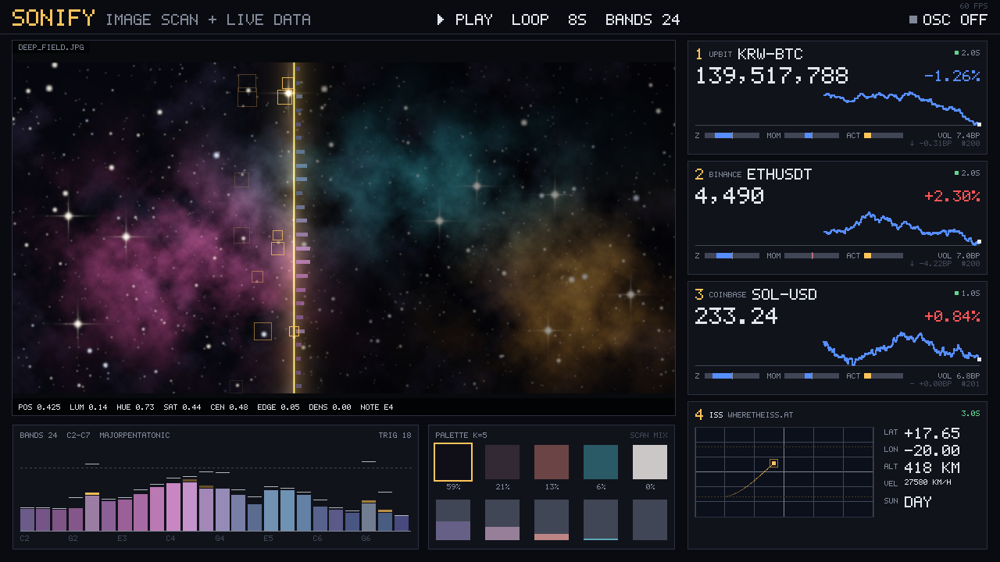

# Sonify for TouchDesigner — 사진 스캔 + 실시간 데이터 → OSC → Ableton

우주 데이터 소니피케이션의 기본형을 TouchDesigner 안에 만드는 틀.

- **사진**을 넣으면 세로 스캔선이 왼쪽에서 오른쪽으로 지나가며 그 줄의 색과 밝기를 읽는다. NASA의 허블·제임스웹 이미지 소니피케이션과 같은 방식이다.
  - 가로 위치는 시간, 세로 위치는 음높이(아래가 낮은 음), 밝기는 음량, 색은 음색에 대응한다.
  - 밝은 별을 지날 때마다 노트 이벤트가 나간다.
- **실시간 API 4개**를 불러온다.
  - 빠르게 움직이는 시세 3개: Upbit KRW-BTC, Binance ETHUSDT, Coinbase SOL-USD
  - 우주 데이터 1개: ISS(국제우주정거장) 현재 위치
- 모든 값을 **OSC**로 보낸다. Ableton에서는 Max for Live나 AbletonOSC로 받는다. 아직 소리를 내지 않아도 된다.
- **UI**는 컨테이너 하나에 들어 있다. 대시보드와 컨트롤 패널이 한 화면에 있고, 사진을 클릭하거나 드래그하면 스캔 위치가 바뀐다.



> 위 그림은 TD 밖에서 같은 렌더러와 가짜 시세로 만든 미리보기다. TD에서는 실제 API 값이 들어간다.

---

## 1. 빠른 시작

**필요한 것**
- TouchDesigner 2023.11000 이상 (Python 3.11, numpy 포함)
- 인터넷 연결
- 이 저장소 (`git clone` 또는 ZIP 다운로드)

**① 빌드 (한 줄)**

TD에서 새 프로젝트를 열고 **Textport**를 연다 (메뉴 `Dialogs > Textport and DATs`, 단축키 `Alt+T`). 아래 한 줄을 붙여넣고, 경로는 내 컴퓨터의 `touchdesigner` 폴더로 바꾼다.

```python
SONIFY_DIR = r'C:/Users/나/212/touchdesigner'; exec(open(SONIFY_DIR + '/build_sonify.py', encoding='utf-8').read())
```

macOS 경로 예: `r'/Users/나/212/touchdesigner'`

다른 방법: `build_sonify.py`를 TD 네트워크로 끌어다 놓고, 생긴 Text DAT을 우클릭한 뒤 **Run Script**.

**② 결과 확인**

Textport에 JSON이 찍힌다.
- `"rep": []` 이면 성공이다.
- `rep`에 항목이 있으면 TD 버전에 따라 이름이 다른 파라미터다. [8. 문제 해결](#8-문제-해결)을 본다.
- `soft` 항목은 없어도 동작하는 부가 설정이다.

`/project1/container1`(이미 있으면 다음 번호)이 생기고, **UI 창이 열린다**. 몇 초 안에 시세가 들어오고 스캔선이 움직인다.

**③ 다시 빌드해도 안전하다**

같은 줄을 다시 실행하면, `sonify` 태그가 붙은 컨테이너만 지우고 새로 만든다. 이때 커스텀 파라미터 값과 OSC 매핑 표는 그대로 되살린다. 내가 만든 다른 노드는 건드리지 않는다.

**④ 숫자로 점검 (선택)**

몇 초 뒤에 실행한다.

```python
SONIFY_DIR = r'C:/Users/나/212/touchdesigner'; exec(open(SONIFY_DIR + '/td/verify_sonify.py', encoding='utf-8').read())
```

확장 에러, 노드 에러, 각 TOP의 해상도와 밝기, CHOP 값, API/OSC 상태가 한 번에 나온다.

---

## 2. 화면과 컨트롤

```
┌ SONIFY ─────────────── ▶ PLAY LOOP 20S BANDS 24 ─────────── ■ OSC 127.0.0.1:9000 ┐ ┌ 컨트롤 ┐
│ ┌ 사진 + 스캔선 ───────────────────────────┐   ┌ 1 UPBIT KRW-BTC ───┐ │ │ Scan   │
│ │  클릭/드래그 = 스캔 위치 이동            │   │ 가격, 24h %, 그래프 │ │ │ Music  │
│ │  선 옆 빗살 = 대역별 밝기                │   ├ 2 BINANCE ETHUSDT ─┤ │ │ Data   │
│ │  □ = 별을 지나며 나간 노트               │   ├ 3 COINBASE SOL-USD ┤ │ │ OSC    │
│ └ POS LUM HUE SAT CEN EDGE DENS NOTE ──────┘   │                    │ │ │ View   │
│ ┌ BANDS (대역 미터) ─────┐ ┌ PALETTE ─────┐   ├ 4 ISS 지도 ────────┤ │ │ Setup  │
└─┴────────────────────────┴─┴──────────────┴───┴────────────────────┴─┘ └────────┘
```

- **컨트롤 패널**(오른쪽)은 컨테이너의 커스텀 파라미터를 그대로 보여준다(Parameter COMP). 네트워크에서 컨테이너를 선택하고 파라미터 창(`P`)을 열어도 같은 컨트롤이 보인다.
- **사진 클릭/드래그**로 스캔 위치를 바꾼다. 네트워크 화면 안의 뷰어에서는 뷰어를 활성화해야 클릭이 먹는다. 그래서 **View 페이지의 Open Window**로 연 창에서 쓰는 게 편하다.
- 시세 색은 **한국식**이다. 상승은 빨강, 하락은 파랑.

### 파라미터 페이지

| 페이지 | 파라미터 | 설명 |
|---|---|---|
| **Scan** | Image File | 스캔할 사진. 기본값은 `assets/deep_field.jpg`(직접 생성한 시험용 우주 이미지) |
| | Source TOP | 사진 대신 카메라나 영상 TOP을 스캔한다. 지정하면 매 프레임 다시 분석한다 |
| | Live Source | Image File이 영상 파일일 때 켠다 |
| | Play / Position | 재생과 스캔선 위치(0~1). Position을 드래그하면 그 자리로 이동한다 |
| | Sweep Seconds | 왼쪽 끝에서 오른쪽 끝까지 걸리는 시간(초) |
| | Mode | Loop / Ping-Pong / Once. Once는 끝나면 Play가 자동으로 꺼진다 |
| | Restart | 처음으로 |
| | Bands | 세로를 몇 개의 대역(음)으로 나눌지 |
| | Line Width | 스캔선 폭(분석 해상도 512px 기준) |
| | Trigger Threshold | 대역의 최대 밝기가 이 값을 넘으면 `/scan/trig` 노트가 나간다 |
| | Palette Colors | 사진에서 뽑을 대표 색 수(k-means) |
| **Music** | Lowest / Highest Note | 맨 아래 대역과 맨 위 대역의 MIDI 음 |
| | Scale / Root | 음계와 으뜸음. 대역 음을 이 음계에 맞춘다 |
| **Data** | Feed 1~3 On / API / Symbol | 공급자: upbit, binance, coinbase, bithumb, sim. 심볼은 `btc`처럼 짧게 써도 형식을 맞춰 준다 |
| | ISS Position | 4번째 API(ISS 위치) 켜기/끄기 |
| | Market Poll / ISS Poll | 요청 간격(초). 기본 1초 / 2초 |
| | Stats Window | z·변동성을 계산할 최근 틱 수 |
| | Smoothing / Activity Release | 연속값 스무딩 시정수, act 엔벨로프 감쇠(초) |
| | SSL | auto: 인증서 검증 실패 시 검증 없이 재시도(macOS TD에서 흔함) / verify / off |
| | Reconnect / Reset Stats | 폴링 재시작 / 통계 초기화 |
| **OSC** | Send OSC / Host / Port | 기본 `127.0.0.1:9000` |
| | Rate (Hz) | 연속값 전송 빈도(기본 30) |
| | Address Prefix | 기본 `/sonify` |
| | Mode | Generic(`/sonify/*`) / Mapped(AbletonOSC 표) / Both |
| | Bundle per Tick | 한 틱 메시지를 번들로 묶는다(패킷 수 감소) |
| | AbletonOSC Port | 기본 11000 |
| | Send Test | `/sonify/test`와 `/live/test`를 한 번 보낸다 |
| **View** | Open / Close Window | UI 창 |
| | Line Color / Glow, Unscanned Brightness | 스캔선 모양 |
| | Panel FPS | 오버레이(그래프·글자) 갱신 빈도 |
| | Flip Overlay | 글자가 위아래로 뒤집혀 보이면 끈다 |
| **Setup** | Python Path | `touchdesigner/python` 폴더 |
| | Reload Python | 파이썬 코드를 고친 뒤 다시 불러온다 |

---

## 3. 데이터(API) 4개

API 키는 필요 없다. 모두 공개 API다.

| # | 기본값 | 요청 주소 | 비고 |
|---|---|---|---|
| 1 | **Upbit KRW-BTC** | `https://api.upbit.com/v1/ticker?markets=KRW-BTC` | 원화 비트코인 |
| 2 | **Binance ETHUSDT** | `https://api.binance.com/api/v3/ticker/24hr?symbol=ETHUSDT` | 지역 차단(451)이면 자동으로 `data-api.binance.vision`으로 바꾼다 |
| 3 | **Coinbase SOL-USD** | `https://api.exchange.coinbase.com/products/SOL-USD/stats` | 24h 등락률 = (last−open)/open |
| 4 | **ISS 위치** | `https://api.wheretheiss.at/v1/satellites/25544` | 실패하면 `api.open-notify.org`로 바꾼다(고도·속도 없음) |
| (선택) | Bithumb | `https://api.bithumb.com/public/ticker/BTC_KRW` | |
| (선택) | sim | 네트워크 없이 랜덤워크 | 오프라인 시험·공연 리허설용 |

- 요청은 **API마다 백그라운드 스레드**에서 돈다. 그래서 응답이 느려도 TD 프레임이 멈추지 않는다.
- HTTP 429(요청 한도)를 받으면 간격을 자동으로 늘린다.
- 1초 폴링에서 24시간 등락률은 거의 움직이지 않는다. 그래서 소리에 쓰기 좋은 **빠른 지표**를 따로 계산한다. 1bp는 0.01%다.

| 값 | 의미 | 범위 |
|---|---|---|
| `price` | 현재가 | |
| `chg24` | 24시간 등락률 | % |
| `ret` | 직전 틱 대비 변화 | bp |
| `vel` | ret의 지수이동평균(모멘텀) | bp |
| `vol` | 최근 ret의 표준편차(변동성) | bp |
| `z` / `zs` | 최근 가격 안에서의 위치(표준점수→tanh) / 스무딩 | −1..1 |
| `norm` / `norms` | 최근 최저~최고 사이 위치 / 스무딩 | 0..1 |
| `mom` / `moms` | 변동성 대비 방향성 tanh(vel/vol) / 스무딩 | −1..1 |
| `act` | 큰 틱이 오면 튀었다 감쇠하는 엔벨로프(타악기 트리거용) | 0..1 |
| `up` | 직전 대비 +1 / 0 / −1 | |
| `age`, `ok` | 마지막 갱신 후 경과 초, 정상 여부 | |

`zs`·`norms`·`moms`는 매 프레임 부드럽게 따라가는 값이다. 1초마다 계단처럼 튀지 않아서 음량이나 필터에 바로 쓰기 좋다.

---

## 4. 사진 → 소리 매핑 (우주 소니피케이션 기본형)

사진을 512×256으로 줄여 분석한다. 스캔선이 지나는 세로줄에서 아래 값을 뽑는다.

| 값 | 의미 | 소리 아이디어 |
|---|---|---|
| `bands` (N개) | 아래→위 대역별 평균 밝기 | 대역 = 음, 밝기 = 음량 (가산 합성/드론) |
| `trig` 이벤트 | 대역의 **최대 밝기**가 임계값을 넘는 순간(별) | 노트 온. 대역이 높을수록 높은 음 |
| `lum` | 줄 전체 밝기 | 마스터 음량 |
| `centroid` | 밝기 무게중심의 높이(0 아래 ~ 1 위) | 음높이, `note`로 음계 양자화 |
| `spread` | 밝기가 위아래로 퍼진 정도 | 화음 폭, 리버브 |
| `hue`, `sat`, `r g b` | 색상·채도·평균색 | 음색, 필터 컷오프 |
| `edge` | 좌우 변화량(경계, 질감) | 노이즈, 디스토션 |
| `contrast`, `density` | 줄 안 명암 차, 밝은 픽셀 비율 | 리듬 밀도 |
| `mix` (k개) | 줄 안에서 팔레트 각 색의 비율 | **색 = 트랙**, 비율 = 그 트랙 음량 |
| `palette` | 사진 전체의 대표 색 k개와 비율 | |

- 트리거는 평균이 아니라 **지나간 구간의 최댓값**으로 판단한다. 그래서 작은 별도 놓치지 않는다. 빠르게 훑어서 프레임 사이 열을 건너뛰어도 마찬가지다.
- 같은 별에서 반복 발사되지 않도록 히스테리시스를 둔다. 임계값의 80% 아래로 내려가야 다시 장전된다.
- 진짜 우주 사진은 NASA/ESA의 허블·제임스웹 공개 이미지를 쓴다. 이용 조건은 각 사이트를 확인한다. Image File에 넣으면 된다.

---

## 5. OSC 주소표 (Generic 모드, prefix `/sonify`)

| 주소 | 인자 | 언제 |
|---|---|---|
| `/sonify/scan/pos` `lum` `r` `g` `b` `hue` `sat` `centroid` `spread` `peak` `contrast` `edge` `density` `playing` `trigvel` | float | 매 틱(Rate Hz) |
| `/sonify/scan/note` `palidx` `trigband` `trignote` | int | 매 틱 |
| `/sonify/scan/rgb` | f f f | 매 틱 |
| `/sonify/scan/bands` | f × N (아래→위) | 매 틱 |
| `/sonify/scan/mix` | f × k | 매 틱 |
| `/sonify/scan/trig` | **i band, i note, f vel** | 별을 지나는 순간(이벤트) |
| `/sonify/feed1/zs` `norms` `moms` `act` (feed2, feed3 같음) | float | 매 틱 |
| `/sonify/feed1/tick` | i up, f ret(bp), f price | 새 시세가 들어온 순간 |
| `/sonify/feed1/price` `chg24` `ret` `vel` `vol` `z` `norm` `mom` `up` `age` `ok` … | float | 새 시세 + 2초마다 |
| `/sonify/feed1/name` | s 공급자, s 심볼 | 2초마다 |
| `/sonify/iss/latn` `lonn` | float (−1..1) | 매 틱 |
| `/sonify/iss/lat` `lon` `alt` `vel` `day` `age` `ok` | float | 새 위치 + 2초마다 |
| `/sonify/meta/bandnotes` | i × N (대역별 MIDI 음) | 2초마다 |
| `/sonify/image/palette`, `/sonify/image/weights` | f × 3k, f × k | 2초마다 |

같은 값은 TD 안에서 **CHOP**으로도 나온다. 컨테이너 안 `null3`~`null6`이고, 코멘트에 `scan`, `feeds`, `bands`, `palette`라고 적혀 있다. 나중에 TD 안에서 직접 소리를 만들 때 이 CHOP을 쓰면 된다.

---

## 6. Ableton으로 보내기

### A. Max for Live로 받기 (별 → MIDI 노트, 값 표시)

1. Live에서 MIDI 트랙을 만들고 **Max MIDI Effect**를 넣는다. 그 뒤에 악기(예: Wavetable)를 둔다.
2. Max MIDI Effect의 편집 버튼으로 Max를 연다.
3. `touchdesigner/ableton/sonify_receive.maxpat`을 Max에서 연다. 전체 선택(⌘/Ctrl+A) → 복사 → 장치 편집 창에 붙여넣고 저장한다.
4. TD가 재생 중이면 **별을 지날 때마다 노트가 울린다**. 대역이 높을수록 높은 음이다.
5. 연속값(lum, centroid, hue, edge, feed*/zs, iss/latn)은 숫자 상자로 들어온다. 원하는 곳에 연결하면 된다.
   - 포트는 패치 왼쪽 위 숫자 상자로 바꾼다(기본 9000 = TD의 Oscport).
   - 패치는 `tools/make_maxpat.py`로 다시 만들 수 있다.

### B. AbletonOSC로 Live 파라미터 직접 움직이기 (Live 11+, 무료)

[AbletonOSC](https://github.com/ideoforms/AbletonOSC)는 Live의 리모트 스크립트다. OSC로 트랙 볼륨, 팬, 디바이스 파라미터, 템포 등을 바꿀 수 있다. M4L이 없어도 된다.

1. AbletonOSC를 받아 `AbletonOSC` 폴더를 Live의 `User Library/Remote Scripts/`에 넣는다.
2. Live의 `Settings`(Live 11은 `Preferences`) `> Link, Tempo & MIDI > Control Surface`에서 **AbletonOSC**를 고른다. 이제 UDP 11000으로 받는다.
3. TD 컨테이너 OSC 페이지에서 **Mode = Both**(기본) 또는 **Mapped**로 둔다.
4. 컨테이너 안 **OSC 매핑 표**(`table1`, 코멘트 "OSC 매핑 표")에서 쓸 행의 `active`를 `1`로 바꾼다.

| active | source | address | args | inmin | inmax | outmin | outmax |
|---|---|---|---|---|---|---|---|
| 1 | scan/lum | /live/device/set/parameter/value | 0 0 1 | 0 | 1 | 0 | 1 |
| 1 | feed1/zs | /live/track/set/volume | 1 | -1 | 1 | 0.45 | 0.85 |
| 1 | feed2/moms | /live/track/set/panning | 2 | -1 | 1 | -1 | 1 |

- `source`는 5장의 값 이름에서 prefix를 뺀 것이다(`scan/centroid`, `feed3/act`, `iss/latn` …).
- `args`는 값 앞에 붙는 고정 인자다. 위 첫 행은 **트랙 0, 디바이스 0, 파라미터 1**이다. 인덱스는 0부터 센다. 디바이스의 파라미터 0은 보통 Device On이다.
- 값은 `inmin..inmax`를 `outmin..outmax`로 직선 변환한 뒤 잘라낸다. 같은 값이면 다시 보내지 않는다(1초마다 한 번은 보낸다).
- 파라미터 번호는 AbletonOSC에 `/live/device/get/parameters/name 0 0`를 보내 확인한다. 응답은 11001 포트로 온다.
- 표는 0.5초 안에 반영된다. 표 오류는 상태 표(`table2`)와 Textport에 나온다.

### C. 확인 도구

```bash
python3 touchdesigner/tools/osc_monitor.py 9000          # 주소별 최신값·초당 개수
python3 touchdesigner/tools/osc_monitor.py 9000 --raw    # 들어오는 그대로
```

한 포트는 한 프로그램만 열 수 있다. 모니터를 켜면 같은 포트의 Max 패치는 받지 못하니, 확인한 뒤 끈다.

---

## 7. TD 네트워크 구조

컨테이너 안 노드는 TD 기본 이름을 그대로 쓰고, 역할은 각 노드의 코멘트에 적혀 있다.

```
moviefilein1 ─┐
noise1 ───────┼─ switch1 ─┬─ resolution1(512x256) ─ null1 ──→ (파이썬 numpyArray: 분석)
select1 ──────┘           │
 (Source TOP)             └─────────────┐
script1 (오버레이, numpy로 그림) ────────┴─ glsl1 (사진+스캔선+오버레이 합성) ─ null2 ─→ container1 배경
script2..5 (scan, feeds, bands, palette) ─ null3..6       (CHOP 출력)
text1 = SonifyExt 확장 (td/SonifyExt.py와 파일 동기화)
execute1 (매 프레임 Tick) · parexec1 (파라미터 → 확장)
table1 (OSC 매핑 표) · table2 (API/OSC 상태)
container1 (대시보드 뷰) · parameter1 (컨트롤 패널) · window1 (UI 창)
```

- 로직은 전부 `python/sonify_td/`의 **순수 파이썬**에 있다. TD 쪽(`td/`)은 값을 옮기는 일만 한다.
- `text1`은 `td/SonifyExt.py`와 **Sync to File**로 연결되어 있다. 파일을 고치면 TD에 반영된다.
- `python/` 아래를 고쳤으면 Setup 페이지의 **Reload Python**을 누른다.

---

## 8. 문제 해결

| 증상 | 확인 |
|---|---|
| 빌드 결과 `rep`에 `SET`/`MENU` 항목 | TD 버전에 따라 파라미터 이름이 다르다. 해당 노드 파라미터 창에서 실제 이름을 보고 `build_sonify.py`를 고친다. TD MCP가 연결된 로컬 Claude 세션이면 [HANDOFF_TD_MCP.md](HANDOFF_TD_MCP.md)대로 맡기면 된다 |
| `rep`에 `EXT:` | 확장 파라미터 이름이 다르다. 컨테이너 Extensions 페이지에 `op('./text1').module.SonifyExt(me)`를 넣고 Re-Init |
| 화면에 글자가 위아래로 뒤집힘 | View 페이지 **Flip Overlay** 끄기 |
| 사진 대신 노이즈가 보임 | Image File 경로 확인(파일이 없으면 noise1로 대체) |
| 피드 카드 `ERR HTTP 451` | 지역 차단. Binance는 자동으로 대체 도메인을 쓴다. 계속 안 되면 공급자를 바꾼다 |
| `SSL 인증서 오류` | Data 페이지 SSL = auto(기본) 또는 off. 카드에 `NOSSL`이 보이면 검증 없이 받는 중이다 |
| `연결 실패` | 인터넷/방화벽 확인. 오프라인이면 공급자를 `sim`으로 |
| 사진 클릭이 안 먹음 | View 페이지 Open Window로 연 창에서 클릭한다(네트워크 뷰어는 활성화해야 함) |
| OSC가 안 옴 | Host/Port 확인, 같은 포트를 다른 프로그램이 쓰는지, 방화벽(다른 컴퓨터로 보낼 때). OSC 페이지 Send Test 후 `osc_monitor.py`로 확인 |
| 확장 로드 실패 | Textport의 `[sonify] 로드 실패` 메시지 확인 → Setup 페이지 Python Path가 `touchdesigner/python`인지 |
| 느려짐 | View 페이지 Panel FPS를 낮추거나 Bands를 줄인다 |

---

## 9. 파일

```
touchdesigner/
  build_sonify.py          TD 안에서 실행하는 빌드 스크립트 (멱등)
  HANDOFF_TD_MCP.md        TD MCP 가 연결된 로컬 Claude 세션용 작업 지시서
  td/                      TD 쪽 코드: 확장, 콜백, GLSL, 검증 스크립트
  python/sonify_td/        순수 파이썬 코어 (TD 없이 테스트 가능)
    engine.py              스캔·피드·OSC 를 묶는 본체
    image_scan.py          팔레트(k-means) + 세로줄 분석
    feeds.py / poller.py   API 공급자·파서·지표 / 백그라운드 폴링
    osc.py / oscmap.py     OSC 인코더·송신기 / AbletonOSC 매핑 표
    render.py / font.py    대시보드 오버레이(numpy) / 5x7 비트맵 폰트
    music.py               음계·양자화
  ableton/sonify_receive.maxpat   Max for Live 수신 패치
  tools/                   OSC 모니터, 미리보기, 시험 이미지·Max 패치 생성기
  assets/deep_field.jpg    시험용 우주 이미지 (코드로 생성, 저작권 없음)
  tests/                   pytest (TD 모의 환경 포함)
```

## 10. TD 없이 테스트

```bash
pip install numpy pillow pytest
python3 -m pytest -q touchdesigner/tests                 # 코어 + TD 모의 환경 빌드/실행 테스트
python3 touchdesigner/tools/preview_dashboard.py out.png  # 대시보드 미리보기 PNG
```

`tests/mock_td.py`는 TD 파이썬 API를 흉내 낸다. 빌드 스크립트, 확장, 콜백의 파이썬 버그는 여기서 잡힌다. 하지만 **실제 TD의 파라미터 이름과 화면은 TD에서 확인해야 한다.** 그 확인 절차가 `td/verify_sonify.py`와 `HANDOFF_TD_MCP.md`다.

## 11. 다음 단계 아이디어

- TD 안에서 바로 소리 내기: `bands` CHOP을 Audio Oscillator 뱅크로 보내는 가산 합성, `trig`는 Audio Play
- MIDI로 보내기: `scan/trig`를 MIDI Out CHOP으로 보내고 IAC/loopMIDI를 거쳐 Ableton으로
- 더 빠른 시세: Binance WebSocket(`wss://stream.binance.com:9443/ws/btcusdt@trade`)으로 체결마다 받기
- 우주 데이터 추가: NOAA SWPC 태양풍(`services.swpc.noaa.gov`), 근지구 소행성(NASA NeoWs) 등은 `feeds.py`에 공급자를 추가하면 된다
